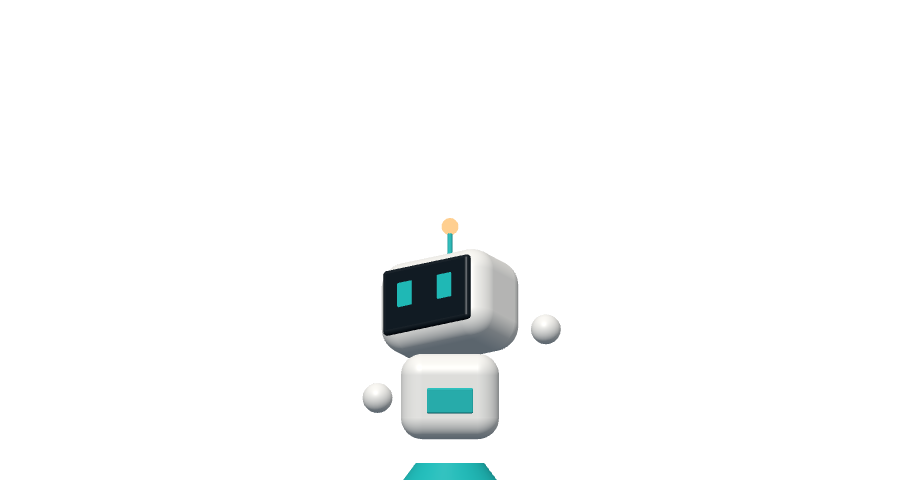

# Desktop Companion

A local-first animated desktop companion for Windows, by Kur1sho.

Characters live on your taskbar, pop up when summoned, and (in later phases) talk with real personalities, dance to your music, play games with you, and do safe tasks you approve. Your data stays on your PC.



## What works so far

- A transparent, always-on-top overlay that covers the screen but lets clicks through everywhere except the character
- The character stands on top of the taskbar and pops up out of it with a little bounce and a wave
- A placeholder **Robotico** built from simple shapes until the real model is ready
- Load any **VRM** model (VRoid Studio, Blender) from the tray menu, or drop one in `assets/characters/` to load it on start
- Idle life: breathing, blinking, and the head follows your mouse
- Drag the character left and right along the taskbar
- Double-click the character, or click the tray icon, to summon it again. Right-click the character for the same menu as the tray icon
- **Bring a friend** (tray menu): Robotico and Suzu together. She follows him everywhere (hopping up onto windows after him, and falling with him when a window closes), grabs on and hangs off him when you pick him up, gazes at him all dreamy-eyed, and now and then they do something together: hold hands, make a heart, a head pat, a boop, leaning on each other, syncing antennas, chatting in beeps, sharing a battery, or a crash and reboot
- **Talk to it**: click the character (or press Ctrl+Shift+T) and type. It answers in a speech bubble, in character, with matching facial expressions
- **Understands typos**: typed messages are spell-checked on your PC first, so "opne spotfy", "set a timre for 5 minuts" and "remidn me tomorow" all work. It only fixes words it's sure about, and leaves names, songs and things to search for as you typed them
- Two personalities: **Robotico** (loud, cocky little robot) and **Suzu** (tsundere, placeholder name)
- **Works out of the box**: a built-in AI brain runs on your PC (GPU if available), downloaded once on first launch, then offline. It runs on llama.cpp and picks the biggest brain your PC can run: Qwen3 14B (about 9 GB) or 8B (about 5 GB) on a graphics card with enough memory, otherwise Qwen3 4B (about 2.5 GB), on the processor if needed. All are Apache-2.0, so the app can be sold. If a graphics card crashes, it steps down and remembers. No accounts, keys or extra installs
- Optional in Settings (tray menu): **Ollama**, or your own key for **Claude**, **OpenAI**, **OpenRouter** or **Gemini** for a smarter, wittier character
- **Wake word**: just say **"Hey Robotico"** (or the current character's name). You can say the question in one go ("Hey Robotico, how are you?") or wait for him to pop up. Heard and understood only on your PC; toggle it in Settings
- **Ignores typing and background noise**: a small built-in speech detector (Silero VAD, MIT licensed) tells a voice apart from keyboard clicks, so the wake word still works while you type and listening stops as soon as you stop talking
- **First-time setup**: on first launch the character downloads and prepares everything once (with a progress bar), so even the first "Hey Robotico" is instant
- **Safe actions**: "open Spotify", "set a timer for 10 minutes", "search for pancakes", "play lofi on Spotify", "pause the music", "skip this song", "turn it up". The character asks **Yes / Always / No** before anything happens (you can answer out loud if you asked by voice). Only the actions in `src/shared/actions.ts` can ever run: no shell commands, no files, and websites always ask. Everything it does is written to an activity log (tray menu → Activity log). On first run it asks once whether it can do simple things without asking (Settings → Actions to change)
- **Reminders, alarms and timers**: "remind me at 6pm to call mum", "remind me to check the oven in 20 minutes", "wake me up tomorrow at 7", "set a timer for 10 minutes". Ask "what reminders do I have?" or say "cancel my timer" / "cancel the oven reminder". They're saved on this PC, so they still go off after a restart (one missed while the app was closed still goes off if it's under 12 hours late). When one is due the character pops up, beeps, says it, and Windows shows a notification too. When a timer runs out, his head drops into the top right corner with a red screen and a flashing warning sign, says "Timer over!" and beeps until you click it.
- **Games**: a game window (tray menu → Play a game, or just say "let's play chess") with **chess**, **checkers**, **Texas Hold'em poker**, **blackjack**, **rock paper scissors**, **trivia** and **higher or lower**. Board games have three difficulty levels; the character plays with its own small chess and checkers brains, and decides poker hands by working out its chances. It trash-talks in character on the desktop while you play. Chips and settings are kept on this PC. **Twenty questions** is a voice game: he picks something and his brain answers your yes/no questions.
- **Welcome screen**: on first launch, a grid of accounts to connect, one click each (tray menu → Connections to reopen), plus the "do simple things without asking" switch
- **Spotify playback**: "play lofi" opens the search in the Spotify app and presses play on the top result, and "play playlist Road Trip" plays that playlist from your library (or search) (via Windows' accessibility interface), so it works for everyone, free or Premium, with no sign-in
- **Runs your desktop**: "switch to Discord", "minimise Spotify", "put Chrome on the left", "make Discord full screen", "close Notepad" (closing always asks); "launch Elden Ring" or "play Minecraft" starts installed Steam games; "lock my PC", "take a screenshot" (saved to Pictures\Screenshots), "dark mode", "dim the screen", "show the desktop"
- **Sees your screen when you ask**: "what's this error?", "look at my screen", "how do I beat this boss?". A local vision brain (Qwen3-VL 4B, Apache-2.0, run by llama.cpp's llama-server, downloaded once) looks at the screen the mouse is on. The picture stays in memory for that one question and is never saved or sent anywhere. The vision brain closes after a few idle minutes to free memory
- **Copied text**: "read what I copied", "translate what I copied into Spanish", "summarise the text I copied". The clipboard is only read when you ask, and its text can never trigger actions
- **Dances to your music**: say "dance" (or "dance to this song") and the character dances to the beat of whatever your PC is playing: Spotify, YouTube, games. The sound is only measured on your PC (Windows audio loopback), never recorded. It stops when the music stops, or say "stop dancing"
- **Interrupt any time**: "Hey Robotico" cuts the character off mid-sentence and cancels any open question
- **Voice**: or press **Ctrl+Shift+Space** and talk. It stops listening when you go quiet, works out what you said on your PC (Whisper, downloaded once), and answers out loud with a voice tuned to each character, with lip sync. Ctrl+Shift+T opens the text box
- Keys are encrypted with Windows' own protection and never shown again; chat history is stored only on your PC, with a button to wipe it

## Running it on Windows

1. Install [Node.js LTS](https://nodejs.org) and [Git](https://git-scm.com)
2. Open a terminal (PowerShell) and run:

   ```powershell
   git clone https://github.com/Kur1sho/desktop-character-ai.git
   cd desktop-character-ai
   npm install
   npm run dev
   ```

   If PowerShell says scripts are disabled, run `Set-ExecutionPolicy -Scope CurrentUser RemoteSigned` once first.

3. Robotico appears above your taskbar near the right. The teal dot in the system tray has the menu (Summon, Load VRM character, Quit).

## Scripts

| Command | What it does |
| --- | --- |
| `npm run dev` | Runs the app with live reload |
| `npm run build` | Builds into `out/` |
| `npm start` | Runs the built app |
| `npm test` | Runs the unit tests |
| `npm run typecheck` | Checks types |

## Project layout

```
src/main/       Electron main process: overlay window, tray, click-through
src/preload/    The safe bridge between the window and the main process
src/renderer/   The 3D scene and characters (three.js + three-vrm)
src/shared/     Code used by both sides (layout maths, message names)
tests/          Unit tests
assets/         Character models (VRM files are git-ignored by default)
```

## Licence

Copyright Kur1sho. All rights reserved.

Third-party code shipped with the app keeps its own licence: chess.js (BSD-2-Clause) for the chess rules; node-llama-cpp (MIT); Silero VAD (MIT); the spelling word list from SCOWL (Kevin Atkinson's permissive licence, kept in `src/shared/spelling/words.ts`). Their licence texts must be included with the installer. The action layer will be published separately under an open-source licence.
